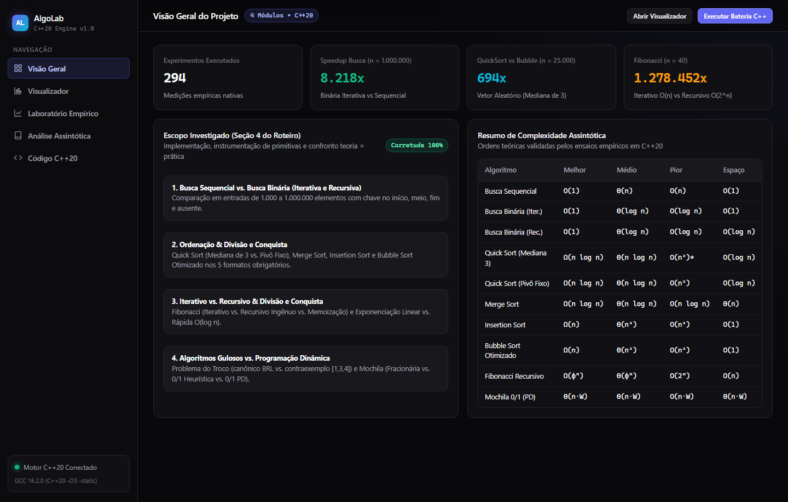
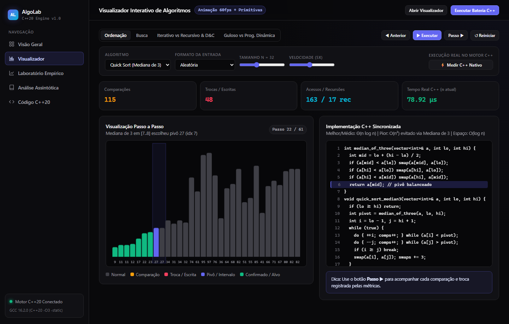
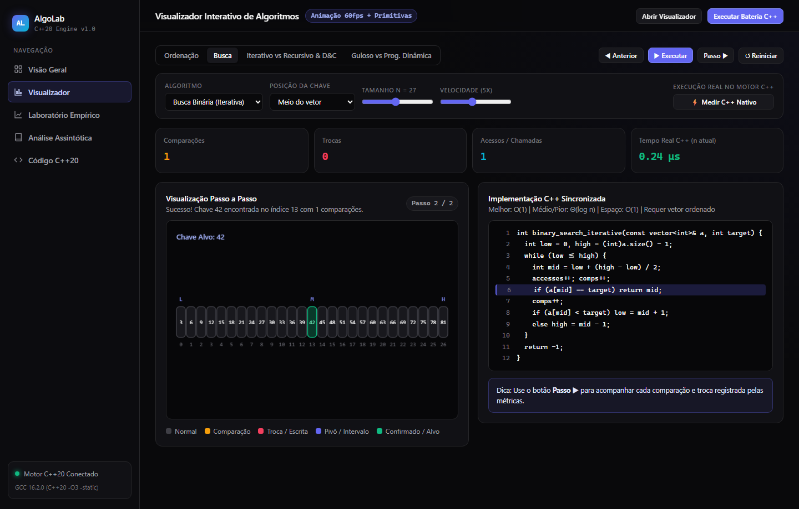
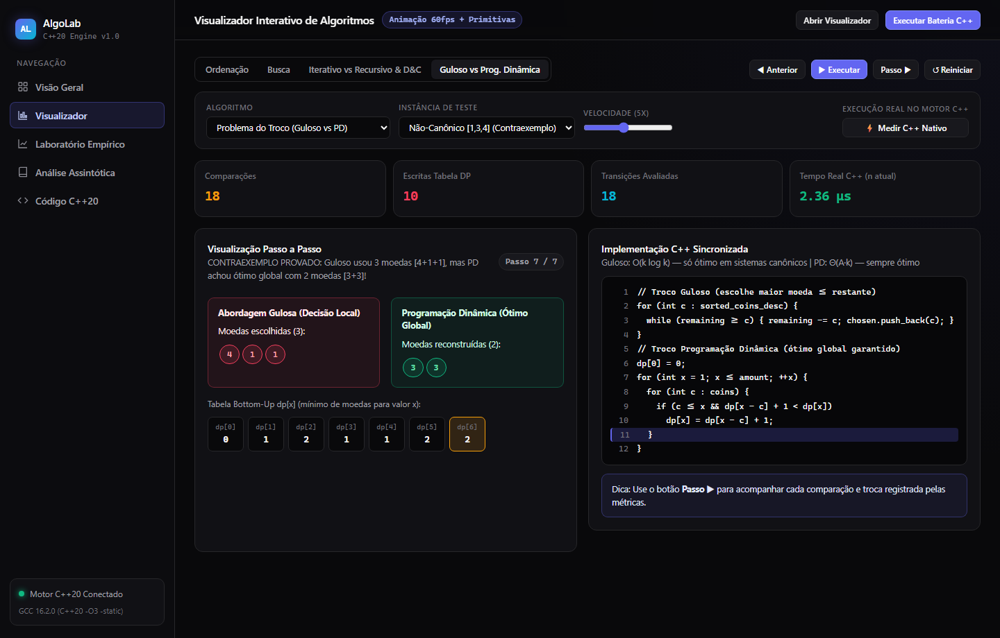
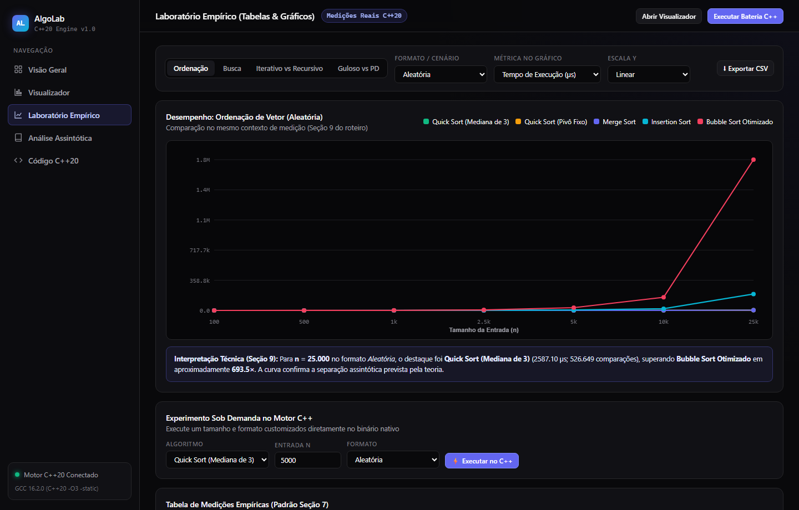
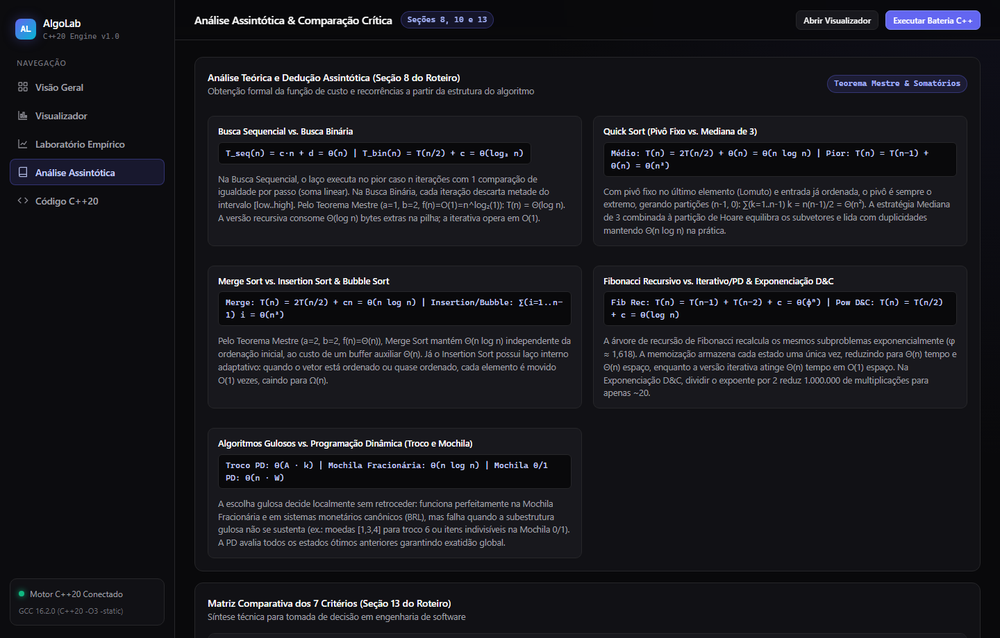

# AlgoLab C++20 — Projeto Prático de Análise de Algoritmos


Plataforma desktop portátil e motor de experimentação científica em **C++20** desenvolvida para o **Projeto Prático de Análise de Algoritmos**, integrando **visualização passo a passo em tempo real**, **instrumentação exata de operações primitivas** e **comparação empírica × assintótica** no ciclo completo:

> **Implementar → Medir → Comparar → Analisar → Justificar**

---

## Download Rápido (`.exe` Portátil)

Baixe o executável único compilado estaticamente (sem dependências externas ou DLLs) na aba **[Releases](https://github.com/fernandocalisto/analise-algoritmos-projeto/releases/latest)**:

- **`AlgoLab.exe`** (`dist/AlgoLab.exe`):
  - **Duplo clique**: abre automaticamente a interface gráfica desktop moderna e minimalista conectada ao motor C++20 nativo.
  - **`AlgoLab.exe --cli`**: executa toda a bateria de 294 experimentos no terminal, exibe as tabelas formatadas e grava `data/benchmark_results.json`.
  - **`AlgoLab.exe --benchmark-json <caminho.json>`**: exporta medições empíricas em JSON estruturado.

---

## Prévia da Interface

| Visão Geral & KPIs | Visualizador de Ordenação (Quick Sort) |
| :---: | :---: |
|  |  |

| Visualizador de Busca Binária | Contraexemplo Guloso vs. Prog. Dinâmica |
| :---: | :---: |
|  |  |

| Laboratório Empírico (Tabelas & Gráficos) | Análise Assintótica & Crítica |
| :---: | :---: |
|  |  |

---

## Algoritmos Investigados (Seção 4 do Roteiro)

1. **Busca**:
   - Busca Sequencial (`O(1)` melhor, `Θ(n)` médio/pior, `O(1)` espaço)
   - Busca Binária Iterativa (`O(1)` melhor, `Θ(log n)` médio/pior, `O(1)` espaço)
   - Busca Binária Recursiva (`O(1)` melhor, `Θ(log n)` médio/pior, `O(log n)` pilha)
2. **Ordenação & Divisão e Conquista**:
   - Quick Sort com Mediana de Três + Partição de Hoare (`Θ(n log n)` robusto)
   - Quick Sort Clássico com Pivô Fixo no Fim / Lomuto (demonstra degradação `Θ(n²)` em entradas ordenadas e repetidas)
   - Merge Sort (`Θ(n log n)` garantido, `Θ(n)` espaço auxiliar)
   - Insertion Sort (`Ω(n)` adaptativo, `Θ(n²)` médio/pior)
   - Bubble Sort Otimizado com parada antecipada (`Ω(n)` ordenado, `Θ(n²)` geral)
3. **Iterativo vs. Recursivo & Divisão e Conquista**:
   - Fibonacci: Iterativo `Θ(n) / O(1)` vs. Recursivo Ingênuo `Θ(φⁿ)` vs. Programação Dinâmica por Memoização `Θ(n) / Θ(n)`
   - Exponenciação: Linear `Θ(n)` vs. Exponenciação Rápida por Divisão e Conquista `Θ(log n)`
4. **Algoritmos Gulosos vs. Programação Dinâmica**:
   - Problema do Troco: Sistema canônico BRL `[1,5,10,25,50,100]` e contraexemplo não-canônico `[1,3,4]` (troco `6`: Guloso usa 3 moedas `4+1+1` vs. PD usa 2 moedas `3+3`)
   - Problema da Mochila: Fracionária Gulosa `O(n log n)` vs. 0/1 Heurística Gulosa vs. 0/1 Programação Dinâmica `Θ(n·W)`

---

## Entregáveis em PDF (`entregaveis/`)

Todos os relatórios parciais e o relatório técnico consolidado (com tabelas reais de `data/benchmark_results.json`, gráficos vetoriais, deduções assintóticas e evidências comentadas) estão na pasta [`entregaveis/`](entregaveis/):

| Entregável | Finalidade | Arquivo |
| :--- | :--- | :--- |
| **Etapa 1 — Planejamento** | Problema, algoritmos selecionados, hipóteses e plano de testes | [`Etapa-1-Planejamento.pdf`](entregaveis/Etapa-1-Planejamento.pdf) |
| **Etapa 2 — Implementação** | Arquitetura C++20, instrumentação e primeiras execuções | [`Etapa-2-Implementacao.pdf`](entregaveis/Etapa-2-Implementacao.pdf) |
| **Etapa 3 — Experimentação** | Medições para múltiplos tamanhos *n* e 6 formatos de entrada | [`Etapa-3-Experimentacao.pdf`](entregaveis/Etapa-3-Experimentacao.pdf) |
| **Etapa 4 — Análise** | Gráficos de desempenho, funções de custo e recorrências | [`Etapa-4-Analise.pdf`](entregaveis/Etapa-4-Analise.pdf) |
| **Etapa 5 — Mini Seminário** | Síntese do projeto, matriz dos 7 critérios e conclusão | [`Etapa-5-Mini-Seminario-Sintese.pdf`](entregaveis/Etapa-5-Mini-Seminario-Sintese.pdf) |
| **Relatório Técnico Completo (EAD)** | Consolidação completa com todas as **12 seções obrigatórias** | [`Relatorio-Tecnico-Completo-EAD.pdf`](entregaveis/Relatorio-Tecnico-Completo-EAD.pdf) |

---

## Estrutura do Projeto

```text
projeto_pratico_algoritmos/
├── include/
│   ├── metrics.hpp                      # Instrumentação de primitivas e tempo
│   ├── data_generator.hpp               # Geradores determinísticos dos 6 cenários de entrada
│   ├── search_algorithms.hpp            # Busca Sequencial e Binária (Iterativa/Recursiva)
│   ├── sorting_algorithms.hpp           # Quick Sort, Merge Sort, Insertion Sort, Bubble Sort
│   ├── recursion_dc_algorithms.hpp      # Fibonacci e Exponenciação Rápida (D&C)
│   ├── greedy_dp_algorithms.hpp         # Problema do Troco e Mochila (Guloso vs. PD)
│   └── web_ui_assets.hpp                # UI e dados embutidos no binário C++
├── src/
│   ├── main.cpp                         # Servidor HTTP WinSock2 + GUI Desktop / Modo CLI
│   ├── benchmark_runner.cpp             # Suite científica de experimentos e exportação JSON
│   └── ui/index.html                    # Interface Web minimalista embarcada
├── data/benchmark_results.json          # Resultados empíricos reais medidos pelo motor C++
├── docs/screenshots/                    # Evidências visuais reais da aplicação e CLI
├── entregaveis/                         # 6 PDFs prontos para entrega nas etapas e no EAD
├── dist/AlgoLab.exe                     # Executável portátil standalone (Windows x64)
└── scripts/
    ├── build.ps1                        # Script de build C++20 estático
    ├── embed_assets.py                  # Empacotador da interface para header C++
    ├── generate_deliverables.py         # Captura screenshots e compila os 6 PDFs
    └── release-workflow.yml             # Template GitHub Actions para CI/Release automático
```

---

## Compilação Local

Requer `g++` com suporte a C++20 (ex.: `w64devkit` ou MSYS2 MinGW-w64) e Python 3:

```powershell
powershell -NoProfile -ExecutionPolicy Bypass -File scripts\build.ps1
```

Para executar os experimentos no console:

```powershell
.\dist\AlgoLab.exe --cli
```
